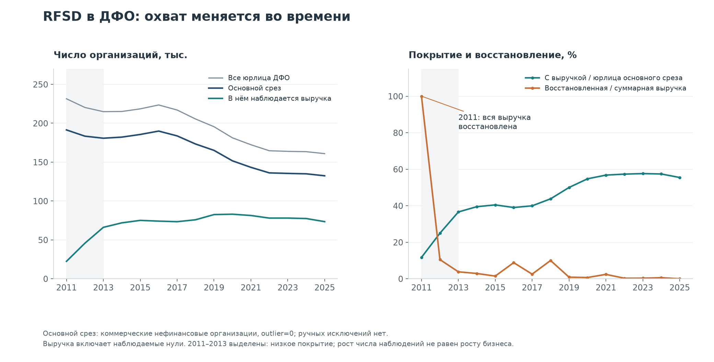
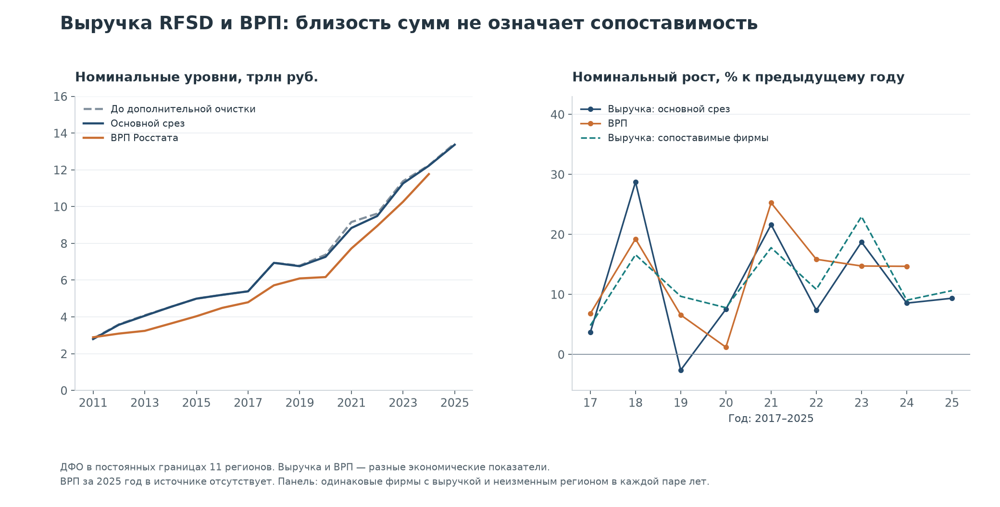
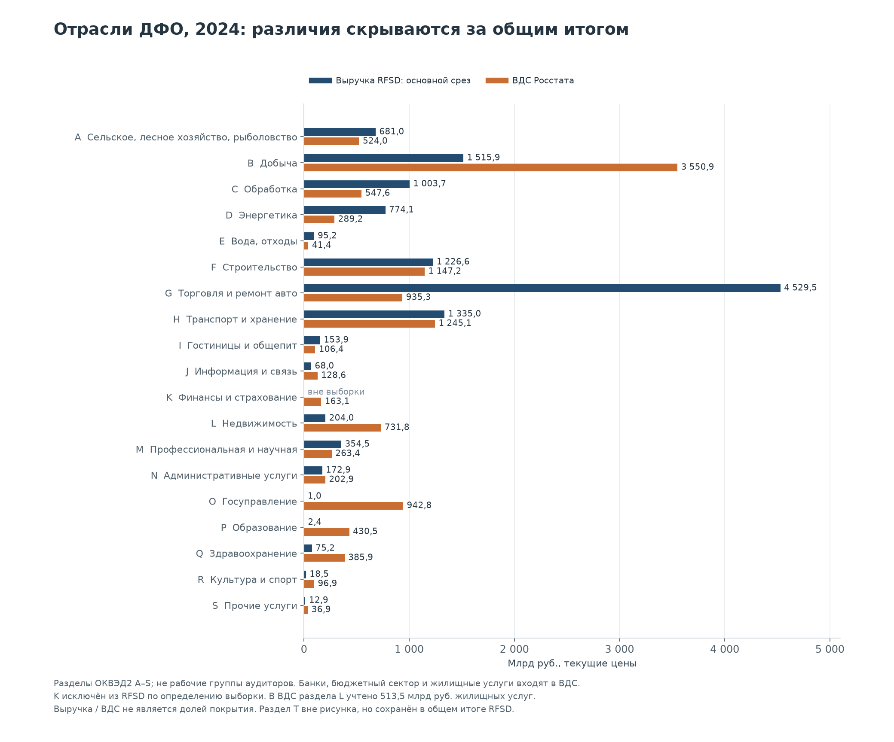
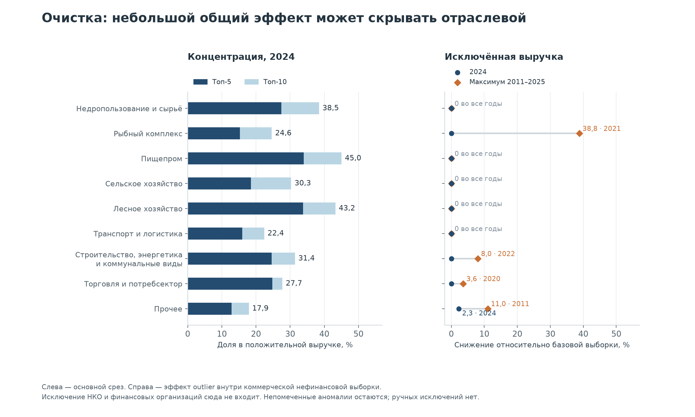

# Графики RFSD и ВРП

Мы собрали четыре рисунка, которые помогают обсудить полноту базы, отраслевую структуру и динамику. В расчётах использована выборка коммерческих нефинансовых организаций ДФО без помеченных выбросов. Её определение — в [приложении](analysis_rules.md).

## Охват базы



Мы видим, что наличие юрлица в базе не всегда означает наличие выручки. В 2011 году она заполнена у 11,7% организаций нашей выборки, причём все эти значения восстановлены из более поздней отчётности. Это одна из причин осторожно относиться к ранней динамике.

Таблицы: `coverage`, `coverage_plot`.

## Выручка и ВРП



Выручка и ВРП близки по общей сумме, но их темпы не всегда совпадают. На рисунке мы также показываем рост одних и тех же фирм в соседних годах, чтобы увидеть влияние состава отчётности. Все темпы здесь номинальные. ВРП за 2025 год в использованном источнике отсутствует.

Таблицы: `macro_levels`, `macro_growth`, `macro_panel`.

## Отрасли



За близкими общими итогами стоят большие отраслевые различия. В торговле выручка превышает ВДС, в добыче — заметно ниже. Их отношение само по себе не измеряет полноту базы: показатели различаются по содержанию. Финансы исключены из нашей выборки RFSD; в недвижимости ВДС включает 513,5 млрд руб. услуг проживания в собственном жилье.

Таблицы: `sectors_2024`, `housing`.

## Крупнейшие компании и выбросы



Слева показана доля крупнейших компаний в положительной выручке каждой рабочей группы. Топ-5 входит в топ-10. Справа — насколько исключение помеченных выбросов уменьшает выручку коммерческих нефинансовых организаций: за 2024 год и в год наибольшего эффекта за 2011–2025. В рыбном комплексе за 2021 год снижение составляет 38,8%.

Мы пока не добавляли ручных исключений. Небольшой эффект метки `outlier` не означает, что остальные записи уже проверены.

Таблица: `cleaning_effects`.

## Воспроизведение

```sh
uv run --locked --group plots python scripts/plot_results.py --audit-run outputs/reproduce/audit --comparison-run outputs/reproduce/comparison --output-dir outputs/reproduce/figures
```

Команда читает результаты проверки RFSD и сравнения с Росстатом, подготовленные по [README](../README.md#полный-повтор-в-новом-клоне). Версия данных и ручные исключения в них должны совпадать. Получаем четыре PNG, четыре SVG и восемь таблиц в CSV/Parquet.

В репозиторий включены четыре PNG из расчёта от 03.10.2026 (`20261003-batch5-figures-v2`). SVG и исходные таблицы создаются при повторе. Для замены рисунков в документах копируем проверенные PNG в `docs/figures/`.
